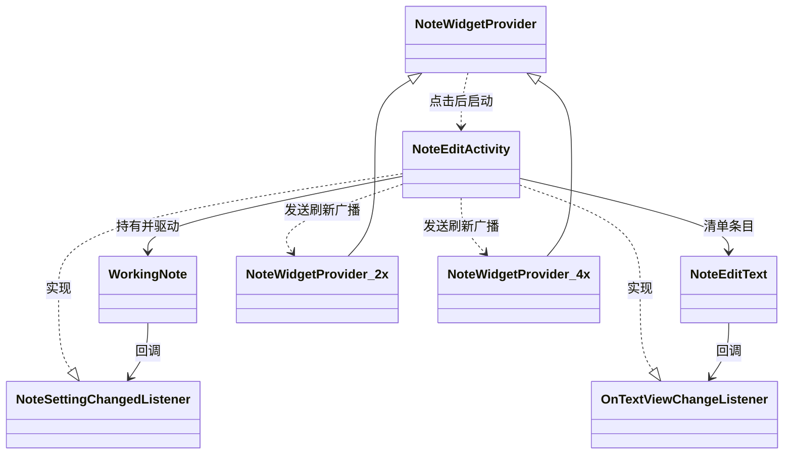

# 成员 3：功能—包—类—方法映射

范围与 `01-scope-and-reading.md` 一致，仅覆盖成员 3 负责的 6 个文件。方法名均来自实际源码。

## 1. 功能 → 包 → 类 → 方法

| 功能 | 包 | 类 | 关键方法 |
|---|---|---|---|
| 新建便签 | `ui` | `NoteEditActivity` | `initActivityState`（`ACTION_INSERT_OR_EDIT` 分支）、`createNewNote` |
| | `model` | `WorkingNote` | `createEmptyNote` |
| 打开 / 加载已有便签 | `ui` | `NoteEditActivity` | `initActivityState`（`ACTION_VIEW` 分支）、`onRestoreInstanceState` |
| | `model` | `WorkingNote` | `load`、`loadNote`、`loadNoteData` |
| 编辑与保存 | `ui` | `NoteEditActivity` | `saveNote`、`getWorkingText`、`onPause`、`onBackPressed`、`onSaveInstanceState` |
| | `model` | `WorkingNote` | `saveNote`、`isWorthSaving`、`existInDatabase`、`setWorkingText`、`getContent` |
| 清单（待办）模式 | `ui` | `NoteEditActivity` | `switchToListMode`、`getListItem`、`onCheckListModeChanged`、`onEditTextEnter`、`onEditTextDelete`、`onTextChange`、`getWorkingText` |
| | `ui` | `NoteEditText` | `onKeyDown`、`onKeyUp`、`onFocusChanged`、`setIndex`、`setOnTextViewChangeListener` |
| | `model` | `WorkingNote` | `setCheckListMode`、`getCheckListMode` |
| 背景色设置 | `ui` | `NoteEditActivity` | `onClick`、`onBackgroundColorChanged`、`initNoteScreen` |
| | `model` | `WorkingNote` | `setBgColorId`、`getBgColorId`、`getBgColorResId`、`getTitleBgResId` |
| 字号设置 | `ui` | `NoteEditActivity` | `onClick`、`initResources`（读取偏好）、`initNoteScreen`（应用样式） |
| 提醒（闹钟） | `ui` | `NoteEditActivity` | `setReminder`、`onClockAlertChanged`、`showAlertHeader` |
| | `model` | `WorkingNote` | `setAlertDate`、`getAlertDate`、`hasClockAlert` |
| 删除便签 | `ui` | `NoteEditActivity` | `onOptionsItemSelected`（`menu_delete`）、`deleteCurrentNote`、`isSyncMode` |
| | `model` | `WorkingNote` | `markDeleted` |
| 分享 | `ui` | `NoteEditActivity` | `sendTo`（`ACTION_SEND`，`text/plain`） |
| 发送到桌面（快捷方式） | `ui` | `NoteEditActivity` | `sendToDesktop`、`makeShortcutIconTitle` |
| 通话记录便签 | `ui` | `NoteEditActivity` | `initActivityState`（通话记录分支）、`onPrepareOptionsMenu`（专用菜单） |
| | `model` | `WorkingNote` | `convertToCallNote` |
| 搜索关键词高亮 | `ui` | `NoteEditActivity` | `initActivityState`（读取搜索 extra）、`getHighlightQueryResult` |
| 菜单动态调整与分发 | `ui` | `NoteEditActivity` | `onPrepareOptionsMenu`、`onOptionsItemSelected` |
| 选择面板收起 | `ui` | `NoteEditActivity` | `dispatchTouchEvent`、`inRangeOfView`、`clearSettingState` |
| 光标定位 | `ui` | `NoteEditText` | `onTouchEvent` |
| 文本链接长按菜单 | `ui` | `NoteEditText` | `onCreateContextMenu` |
| 桌面小部件显示 | `widget` | `NoteWidgetProvider` | `update`（两个重载）、`getNoteWidgetInfo` |
| | `widget` | `NoteWidgetProvider_2x` / `_4x` | `onUpdate`、`getLayoutId`、`getBgResourceId`、`getWidgetType` |
| 小部件刷新通知 | `ui` | `NoteEditActivity` | `updateWidget`、`onWidgetChanged` |
| | `model` | `WorkingNote` | `setWidgetId`、`setWidgetType`、`getWidgetId`、`getWidgetType` |
| 小部件解除绑定 | `widget` | `NoteWidgetProvider` | `onDeleted` |

## 2. 类概览

| 类 / 接口 | 所在文件 | 继承 / 实现 | 职责 |
|---|---|---|---|
| `WorkingNote` | `model/WorkingNote.java` | — | 正在编辑的便签的内存模型，攒变更并保存 |
| `WorkingNote.NoteSettingChangedListener` | 同上（内部接口） | — | 设置变化回调：`onBackgroundColorChanged`、`onClockAlertChanged`、`onWidgetChanged`、`onCheckListModeChanged` |
| `NoteEditActivity` | `ui/NoteEditActivity.java` | `extends Activity implements OnClickListener, NoteSettingChangedListener, OnTextViewChangeListener` | 便签编辑页 |
| `NoteEditActivity.HeadViewHolder` | 同上（内部类） | — | 标题栏控件引用的持有者 |
| `NoteEditText` | `ui/NoteEditText.java` | `extends EditText` | 清单条目输入框 |
| `NoteEditText.OnTextViewChangeListener` | 同上（内部接口） | — | 条目回调：`onEditTextDelete`、`onEditTextEnter`、`onTextChange` |
| `NoteWidgetProvider` | `widget/NoteWidgetProvider.java` | `abstract class extends AppWidgetProvider` | 小部件公共逻辑，三个抽象方法交子类实现 |
| `NoteWidgetProvider_2x` | `widget/NoteWidgetProvider_2x.java` | `extends NoteWidgetProvider` | 2x 小部件 |
| `NoteWidgetProvider_4x` | `widget/NoteWidgetProvider_4x.java` | `extends NoteWidgetProvider` | 4x 小部件 |

## 3. 类间关系

要点：

- `NoteEditActivity` 与 `WorkingNote` 是双向协作：Activity 调用 `WorkingNote` 修改数据，`WorkingNote` 通过 `NoteSettingChangedListener` 回调 Activity；
- `NoteEditText` 与 `NoteEditActivity` 同样通过监听接口解耦；
- 小部件与编辑页互相引用：编辑页保存后广播刷新小部件，小部件点击后启动编辑页。

## 4. 对本范围之外的依赖

| 被依赖的类 | 使用位置 | 负责成员（按标注分工） |
|---|---|---|
| `Note` | `WorkingNote`（变更集、`syncNote`、`getNewNoteId`） | 成员 1 |
| `Notes`（含 `NoteColumns`、`DataColumns`、`TextNote` 等常量） | `WorkingNote`、`NoteEditActivity`、`NoteWidgetProvider` | 成员 1 |
| `DataUtils` | `NoteEditActivity`（存在性检查、删除、移动、按号码查通话便签） | 成员 1 |
| `ResourceParser` | `WorkingNote`、`NoteEditActivity`、`NoteWidgetProvider` 及子类 | 成员 1 |
| `NotesListActivity` | `NoteEditActivity`、`NoteWidgetProvider` | 成员 2 |
| `DateTimePickerDialog` | `NoteEditActivity.setReminder` | 成员 6 |
| `AlarmReceiver` | `NoteEditActivity.onClockAlertChanged` | 成员 6 |
| `NotesPreferenceActivity` | `NoteEditActivity.isSyncMode`（读取同步账号名） | 成员 6 |
